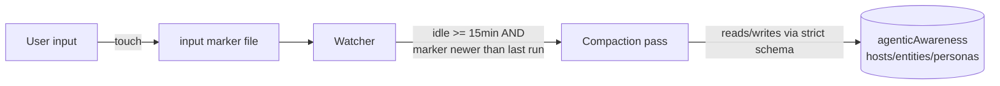
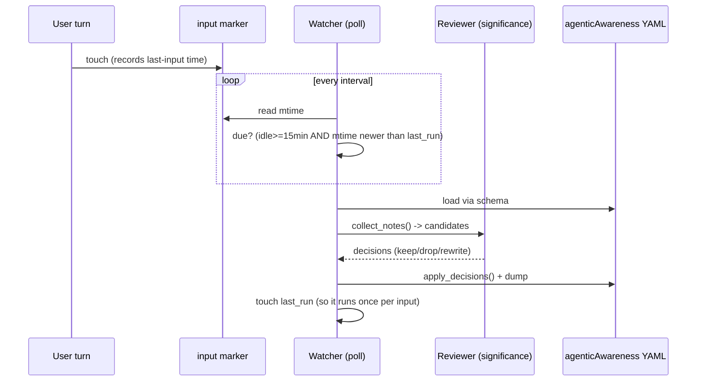
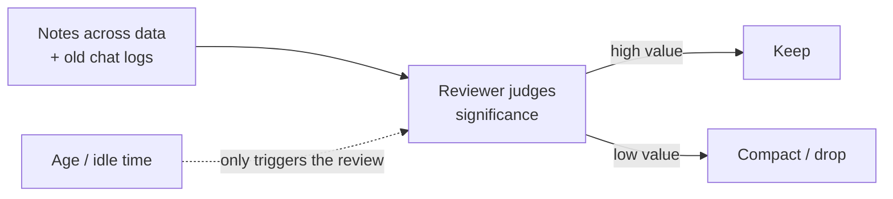

# simple-memory

Significance-based **auto-compaction** of the `notes` values in the
[agenticAwareness](../agenticAwareness) data files. It is deliberately small:
for now it runs **once after the last user input**, after a set idle pause
(default **15 minutes**), and asks the agent to find low-value notes to compact.

Two rules it is built on:
- **Idle pause only gates *when* we ask.** It never deletes on a timer.
- **Removal is by significance, not time.** Old != low-value.

## How it plugs into agenticAwareness



## The one-pass lifecycle



## Significance, not time



## Reviewers

- `keep` (default): `default_reviewer = keep_all` — safe, nothing is dropped.
- `llm`: `LLMReviewer` posts the manifest to an OpenAI-compatible endpoint
  (default: the bigUnsloth proxy `http://127.0.0.1:8787/v1`, model
  `unsloth/Qwen3.8-Flash-Next-GGUF`) and asks it to judge each note. If the
  proxy is unreachable or returns unparseable output it falls back to keep-all,
  so a bad model never corrupts the KB.

Override with `SIMPLE_MEMORY_BASE_URL`, `SIMPLE_MEMORY_MODEL`,
`SIMPLE_MEMORY_TIMEOUT`, `UNSLOTH_PROXY_API_KEY`.

## Run it

```sh
# one evaluation (safe reviewer)
python -m simple_memory --input-marker ~/.local/share/last-user-input --once

# one evaluation using the LLM reviewer
python -m simple_memory --input-marker ~/.local/share/last-user-input --once --reviewer llm

# continuous watcher (poll every 60s)
python -m simple_memory --input-marker ~/.local/share/last-user-input
```

`--kb` defaults to `~/repos/agenticAwareness`; `AGENTICAWARENESS_ROOT` overrides.
`--idle` sets the pause (default 15). The watcher triggers once per user input
via an `input-marker` file you touch on every user turn.

## Status

Minimal by design. The reviewer, chat-log source, and scheduling are stubs to
build on later.
